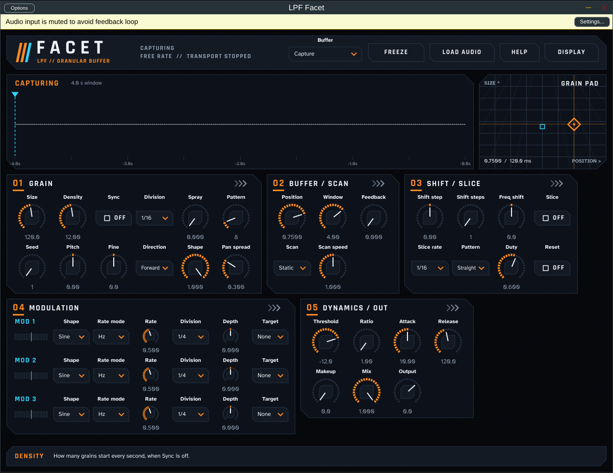

# Facet — granular buffer, played by audio or MIDI, from stereo to 16 channels

A JUCE plugin (VST3 / AU / Standalone) built around a **rolling capture buffer** and a
**granular engine that repeats exactly**: the same settings at the same song position always
give the same result.

By **Life Pass Filter** — [lifepassfilter.com](https://lifepassfilter.com).
In your host it appears as **Facet (Life Pass Filter)**.



## Modes

One plugin, three **Mode** settings (top of the window):

- **Audio**: Facet keeps recording what goes through the track and grains play all the time.
- **MIDI**: silent until you play; each note starts grains transposed around *Root*, with
  *Attack* and *Release* (section 06 NOTES), up to 8 notes at once.
- **Both**: the continuous texture, plus notes played on top.

The buffer source (Capture, Freeze, File) does not depend on the mode: you can capture your guitar
live and play it from a keyboard.

Facet is an effect that also takes MIDI. In Reaper this works everywhere (audio or MIDI tracks).
Ableton Live and Logic do not send MIDI notes to audio effects, so the MIDI and Both modes need Reaper,
Bitwig or another host that does.

## Download

Every push to `main` builds Windows and macOS on GitHub Actions and publishes a release:
[latest release](../../releases/latest).

- `LPF-Facet-Windows.zip`: `Facet.vst3` and the standalone `Facet.exe`
- `LPF-Facet-macOS.zip`: VST3, AU (`.component`) and standalone `.app`, universal (Apple Silicon + Intel)

## Install

The binaries are not signed.

**Windows**
1. Right-click the zip → *Properties* → tick *Unblock* → OK, then extract.
2. Copy both `.vst3` folders to `C:\Program Files\Common Files\VST3\`.
3. In Reaper: *Options → Preferences → Plug-ins → VST → Re-scan*.

**macOS**
1. Copy the `.vst3` files to `~/Library/Audio/Plug-Ins/VST3/` and the `.component` files to `~/Library/Audio/Plug-Ins/Components/`.
2. Remove the quarantine flag on each one, for example:
   ```bash
   xattr -dr com.apple.quarantine ~/Library/Audio/Plug-Ins/VST3/"Facet.vst3"
   xattr -dr com.apple.quarantine ~/Library/Audio/Plug-Ins/Components/"Facet.component"
   ```
3. Rescan plugins in your host.

**Updating from an older version:** delete `LPF Facet.vst3`, `LPF Facet Inst.vst3` and
`Facet Instrument.vst3` (and their `.component` on macOS) before installing, then rescan.
Facet Instrument no longer exists: use Facet with Mode set to MIDI.

**Reaper tip:** to use the keyboard shortcuts (F, H, D, M) inside the plugin window, enable
*Send all keyboard input to plug-in* in the FX window's `+` menu.

## Build from source

Windows: Visual Studio 2022 ("Desktop development with C++") and Git. macOS: Xcode and CMake.

```bash
cmake -B build -DCMAKE_BUILD_TYPE=Release                # downloads JUCE 8.0.4
# or: cmake -B build -DJUCE_DIR=/path/to/JUCE
cmake --build build --config Release
```

The plugins end up in `build/LPF_Facet_artefacts/Release/` and `build/LPF_FacetInst_artefacts/Release/`.
On macOS you also get AU. To add AAX, add `AAX` to `FACET_FORMATS` and call
`juce_set_aax_sdk_path(...)`.

Offline test (checks levels, NaNs, and that two renders are bit-identical):

```bash
cmake -B build -DFACET_BUILD_TESTS=ON
cmake --build build --config Release
ctest --test-dir build -C Release --output-on-failure
```

## How it works

| Block | What it does |
|---|---|
| **Buffer** | *Capture* keeps writing into an 18 s ring buffer. *Freeze* stops writing. *File* plays a dropped or loaded file (up to 18 s). *Window* sets how much recent audio is playable. *Feedback* writes the wet signal back into the buffer, so the sound stacks and layers on itself. |
| **Grain Pad** | X = position, Y = grain size. The orange ring is your setting; the blue trail shows where modulation actually puts the grains. |
| **Grain clock** | Free (*Density*, grains/s) or *Sync* (tempo division). While the host is playing, the clock locks to the song position, so the result repeats exactly on every pass. |
| **Pattern / Seed** | Spray, pan and per-grain variation come from a hash of *(grain index mod Pattern, Seed)*, not from noise. The grain sequence repeats every *Pattern* grains. Change *Seed* for a different but fixed variation. |
| **Scan** | Moves the read head through the window: Static, Forward, Reverse, Ping-Pong, or One-Shot (restarts on each note). |
| **Direction** | Forward, reverse, or alternate (every other grain plays reversed). |
| **Shift** | *Shift Step × (step mod Shift Steps)* semitones per grain, which gives arpeggiated grain clouds. *Freq Shift* is a Hilbert-based single-sideband frequency shifter on the wet signal. |
| **Slice** | Gate synced to tempo, with 8 patterns and a duty control. *Reset Scan* restarts the scan and forces a grain at each slice. |
| **Modulation** | 3 modulators: Sine, Triangle, Saw ±, Square, Step and Drift (the last two are seeded, so they also repeat). Rate modes: *Hz*, *Sync*, *Grain* (one cycle per grain period) and *Link* (rate = 1 / grain size). Each has 12 targets. |
| **Dynamics / Out** | Compressor on the wet signal (Ratio 1 = off), Mix, Output, and an always-on safety limiter. |
| **MIDI learn** | Right-click any knob, then move a controller. Mappings are saved with the session. |

## Read heads & multi-output

Up to **4 read heads** play from the same buffer at the same time (the **HEADS** tab).

- Each head reads at **Position + Offset**, so the grain pad moves them together while they keep their spacing.
- Per head: On, **Link**, Offset, Pitch (added to the main pitch), Level, Pan, **Output**.
- **Link on** (default): the head follows the main GRAIN and SCAN settings, with its own fixed variation.
  **Link off**: the head uses its own Size, Density, Division, Spray, Direction, Shape, Scan, Scan speed,
  Pattern and Seed (press **EDIT** to show them; **COPY MAIN** starts from the current sound).
  **LINK ALL / UNLINK ALL** switch every head at once.
- Modulation, Shift, Slice and dynamics apply to every head.
- The buffer view shows the heads as numbered diamonds and their grains in one lane per head.

**Head stems.** With *Output: Head stems (8 ch)*, each head plays on its own stereo pair
(*Stem* in the HEADS tab: 1-2, 3-4, 5-6, 7-8). Pair 1-2 carries the dry/wet mix; the others carry
only the heads sent to them.

## Space: stereo to 16 channels

The **SPACE** tab uses the same output formats, channel order and panning as Sediments:

- **Output**: Stereo; rings of 4, 5, 6, 7, 8, 10, 12 or 16 speakers; Ambisonics 1st to 3rd order
  (AmbiX: ACN / SN3D); 5.1, 7.1, 5.1.2, 5.1.4, 7.1.2, 7.1.4, 9.1.6 (SMPTE / Dolby order, with
  *Centre speaker* and *Feed LFE* options); or Head stems (8 ch).
- **Place by**: where each grain is heard. *Centre* (in front), *Each head* (one direction per head,
  drag the handles in the room view), *Buffer position* (where the grain reads), *Pattern step*
  (each step of the pattern has its own place: spatial patterns that repeat), *Pitch*.
- **Height**: *Flat*, *Dome* (above you), *Sphere* (above and below: for games and VR, best with
  Ambisonics), *Pitch*, *Grain size* (short grains high, long grains low).
  Each head also has its own height offset.
- **Width**, **Scatter** (follows the seed, so it repeats), **Rotation** (degrees per second, locked to
  the song while it plays). Rotation, Width and Scatter are also modulation targets.
- The room view shows the speakers and every grain where it is heard (filled above ear level,
  hollow below).
- The dry signal stays in front (L / R). Compressor and safety limiter are linked over all channels.

In Reaper: set the track to the number of channels the format needs (*Route* → *Track channels*).
Facet's outputs 1-16 go straight to the track channels. For Ambisonics, add your usual decoder
(binaural or speakers) after Facet.

## Interface & accessibility

Angular "anti-grav HUD" look (original design: chamfered panels, segmented arcs, numbered sections).
Accessibility comes first, with the same approach as Conversations and Sediments:

- **Display panel** (`DISPLAY` or **D**): 4 themes (Anti-grav dark, Daylight, High contrast, Night),
  4 colour palettes (Standard, Blue/orange for red-green colour blindness, Red/teal for blue-yellow,
  Monochrome), fonts (Atkinson Hyperlegible, OpenDyslexic, system font), size 100 to 150 %,
  styled or plain headings, reduced motion, hints bar. Saved per user and shared by every Facet window.
- **Colour is never the only cue**: toggles show a filled square and ON/OFF, grains are triangles,
  the read head is a chevron, modulation is drawn as hollow squares.
- **Hints bar**: one plain sentence explaining the control under the mouse or keyboard focus.
- **Full keyboard control**: Tab / Shift+Tab; arrows adjust (Shift = fine); Page Up/Down; Home/End;
  Delete resets; M = MIDI learn; F = freeze; H = help; D = display; Esc closes panels.
  The grain pad works with the arrow keys. A visible focus ring is always drawn.
- **Screen readers**: every control has a title and a description; announcements for freeze, file loaded,
  MIDI learn. The grain pad reads out its position and size.
- **Quick start** panel on first launch (3 steps + shortcuts).

Fonts (SIL Open Font License, see `fonts/licenses`): Atkinson Hyperlegible, OpenDyslexic, Rajdhani.

## Notes / next steps

- Modulation is computed every 32 samples. Grain parameters are fixed at the moment each grain starts.
- In Capture mode, grains are kept behind the write head (pitched-up grains get extra margin).
- In MIDI and Both modes, each note starts one voice per active head (up to 32 voices).
- Not built yet: preset browser, modulators with several targets each, per-grain filter, MPE.

## License

© 2026 Antoine Boucherikha (Life Pass Filter). Facet is free software: you can redistribute it and/or modify it under the terms of the GNU Affero General Public License, version 3 (see `LICENSE`). It comes with no warranty.

It is built with JUCE (used under AGPLv3) and other open-source components listed in `THIRD_PARTY_NOTICES.md`. Every release zip includes these files.
